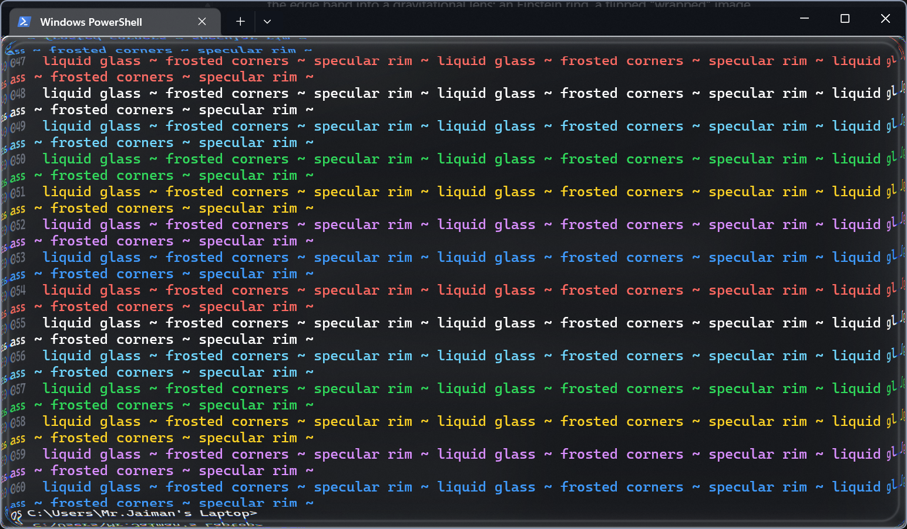
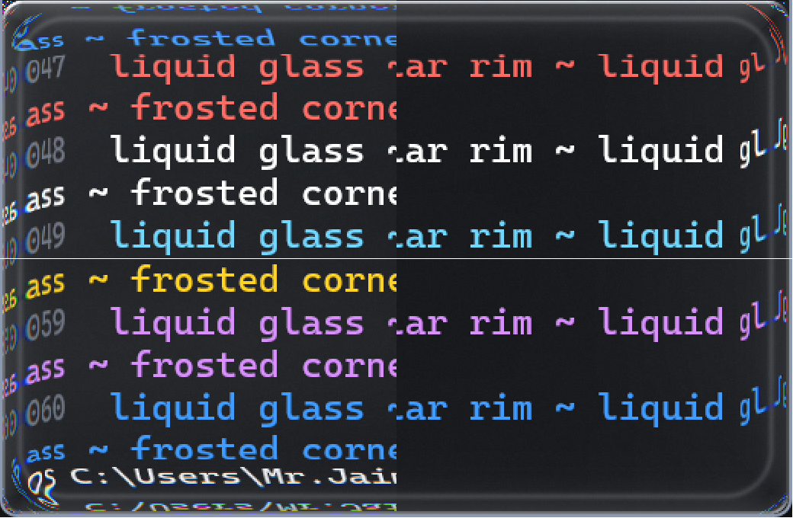
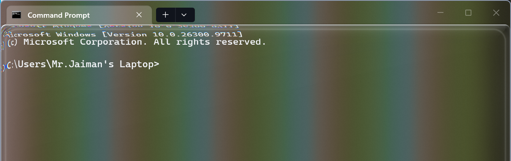

# WTGlass

Apple-style Liquid Glass for Windows Terminal, with a black-hole twist: the
edges of the terminal bend light like a gravitational lens, and the desktop
around the window curves as you drag it.



There are two pieces:

| Piece | What it does |
|---|---|
| [`shader/liquid-glass.hlsl`](shader/liquid-glass.hlsl) | A Windows Terminal pixel shader. The interior stays pixel-sharp; only a band around the edge bends light (Einstein ring, a flipped wrap-around image, frame-dragging swirl, RGB dispersion), plus a specular rim, bloom and sheen. |
| [`spacewarp/`](spacewarp) | **TerminalSpaceWarp**, a small tray app that bends the *desktop* around every Windows Terminal window, like [hyprglass](https://github.com/hyprnux/hyprglass) does on Hyprland. |



## Requirements

- Windows 11 with **Transparency effects** on (Settings > Personalization > Colors)
- Windows Terminal 1.22 or newer
- .NET 10 SDK, to build TerminalSpaceWarp

## Install the shader and theme

1. Clone this repo somewhere permanent.
2. Open Windows Terminal's settings (`Ctrl+,`, then **Open JSON file**).
3. Merge in [`settings/liquid-glass.settings.json`](settings/liquid-glass.settings.json), and point
   `experimental.pixelShaderPath` at `shader\liquid-glass.hlsl` in your clone.
4. Save. Open tabs pick it up straight away.

The settings set `padding` to `0` and hide the scrollbar, so the glass reaches the window
edge. The tab bar uses `terminalBackground` with `useAcrylicInTabRow` off, so it gets the
same blur as the terminal body.



### Tuning the shader

Every effect is a `#define` at the top of the shader. Save the file and open a new tab to
see a change.

| Setting | Effect |
|---|---|
| `LENS_WIDTH` | How far in from the edge light bends (the interior is never touched) |
| `RING_POSITION` | Where the Einstein ring sits, from 0 (the edge) to 1 (the band's inner side) |
| `MIRROR_DEPTH` | How much the flipped copy at the edge shows (0 removes it) |
| `SWIRL` | Frame dragging along the edge (0 turns it off) |
| `DISPERSION`, `PHOTON_RING`, `HORIZON_SHADOW` | RGB split, ring glow, edge darkening |
| `SPECULAR`, `BLOOM`, `FRESNEL`, `SHEEN` | Glass lighting |
| `ANIMATE` | 1 makes the light drift slowly (redraws every frame, so it costs battery) |

## TerminalSpaceWarp

A Windows Terminal shader only ever sees the terminal's own pixels, never the desktop
behind it. Hyprland plugins get that from the compositor; on Windows this app does it
itself. It puts a click-through ring just outside each terminal window, captures the
desktop with the Desktop Duplication API, lenses it in a pixel shader, and shows the
result through DirectComposition, once per display refresh.

```powershell
dotnet build -c Release spacewarp
.\spacewarp\bin\Release\net10.0-windows\TerminalSpaceWarp.exe
```

It lives in the tray: **Pause**, **Start with Windows**, **Exit**. The lens settings are the
`Lens` constants at the top of [`Program.cs`](spacewarp/Program.cs); rebuild after changing them.

Things to know:

- The ring is excluded from screen capture, or it would capture and re-lens its own
  output. That means screenshots and screen recordings don't show it.
- It hides itself when a terminal is maximized, fullscreen or minimized.
- Windows only hands over the previous desktop frame, so a very fast drag can briefly
  smear the terminal onto the trailing edge.
- Debug flags: `--test-pattern` (a flat magenta ring screenshots can see),
  `--dump <folder>` (save each ring's frame), `--stats <file>` (frames per second).
